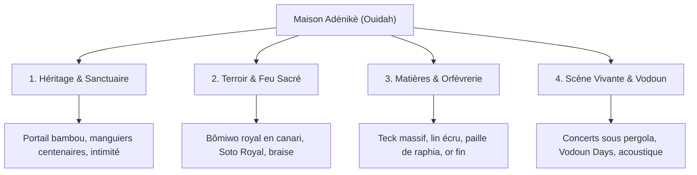

# CHARTE GRAPHIQUE & IDENTITÉ DE MARQUE
## MAISON ADÉNIKÈ — OUIDAH, BÉNIN
*Édition Officielle 2026-2027 • Haute Hospitalité, Résidences de Charme & Table de Terroir*

---

> **Devise Yoruba de la Maison :** *« Ibi yìí L'ọkàn ń Sinmi »*  
> *(« En ce lieu béni, le cœur et l'âme trouvent le repos »)*  
> **Signature de Marque :** *L'Écrin de Ouidah • Haute Hospitalité & Art de Vivre Béninois*

---



---

## SOMMAIRE EXÉCUTIF

1. [Essence, Histoire & Plateforme de Marque](#1-essence-histoire--plateforme-de-marque)
2. [Architecture du Logo & Sceau Officiel](#2-architecture-du-logo--sceau-officiel)
3. [Système Chromatique & Tonalités de Terroir](#3-système-chromatique--tonalités-de-terroir)
4. [Typographie & Échelle de Texte (Type Scale)](#4-typographie--échelle-de-texte-type-scale)
5. [Grammaire Visuelle & Finitions d'Orfèvrerie (Double-Bezel)](#5-grammaire-visuelle--finitions-dorfèvrerie-double-bezel)
6. [Direction Artistique Photographique & Iconographie](#6-direction-artistique-photographique--iconographie)
7. [Ton de Voix & Rhétorique Éditoriale (Voice & Tone)](#7-ton-de-voix--rhétorique-éditoriale-voice--tone)
8. [Déclinaisons Print, Hôtelières & Digitales](#8-déclinaisons-print-hôtelières--digitales)
9. [Matrice des Interdictions Strictes (Brand Don'ts)](#9-matrice-des-interdictions-strictes-brand-donts)

---

## 1. ESSENCE, HISTOIRE & PLATEFORME DE MARQUE

### 1.1 L'Ancrage Territorial : Ouidah la Céleste
La Maison Adénikè ne s'implante pas simplement à Ouidah : elle fait corps avec son histoire pluriséculaire. Nichée dans le quartier paisible de Lêbou / Gomè, à quelques encablures de la Forêt Sacrée de Kpassè et de la lagune côtière, la maison a été conçue comme une **résidence de villégiature et d'honneur** pour les personnalités, les délégations internationales, la diaspora et les voyageurs en quête d'élévation culturelle et de repos physique.

### 1.2 Le Nom : Adénikè
En langue yoruba et fon, **Adénikè** (ou *Adénikè*) signifie littéralement :  
*« La couronne est entourée de tendresse et de respect »* ou *« La royauté honorée par l'amour »*.  
Le nom porte en lui une double polarité :
- **La Noblesse (Adé) :** Exigence de service cinq étoiles, discrétion aristocratique, finitions en orfèvrerie et bois précieux.
- **La Douceur Hospitalière (Nikè) :** Accueil bienveillant, canaris d'argile fumants au feu de bois, tisanes d'accueil, sérénité des chambres.

### 1.3 Les 4 Piliers Fondateurs

| Pilier | Définition Conceptuelle | Traduction Expérientielle |
| :--- | :--- | :--- |
| **I. Le Sanctuaire Confidentiel** | Un refuge clos, sécurisé et verdoyant, préservé du tumulte urbain. | Portail de bambou majestueux, cour d'honneur sablonneuse, conciergerie 24/7. |
| **II. Le Feu Cérémonial & Terroir** | La gastronomie vivante de la terre béninoise, magnifiée sans être dénaturée. | Bômiwo royal en canari, poissons braisés de l'Atlantique, Soto Royal aux racines d'Afrique. |
| **III. La Matière Noble** | Le dialogue sensoriel entre artisanat traditionnel et élégance contemporaine. | Bois de teck massif ciré, lin écru lavé, calebasses évidées, textiles indigo artisanaux. |
| **IV. La Scène Festive & Sacrée** | La vibration musicale et spirituelle sous les cieux étoilés de Ouidah. | Concerts acoustiques exclusifs, banquets impériaux, quartier général des Vodoun Days. |

---

## 2. ARCHITECTURE DU LOGO & SCEAU OFFICIEL

### 2.1 Composition de l'Écusson
Le logotype officiel de la Maison Adénikè associe :
1. **Le Lotus Solaire Stylisé (Couronne d'Orfèvrerie) :** Symbole d'éclosion, de pureté des intentions et de renaissance dans la cité des esprits sacrés.
2. **Le Monogramme MA Entrelacé :** Calligraphie statutaire fusionnant les lettres « M » et « A » dans un équilibre géométrique royal.
3. **Le Lettrage Typographique Principal :** `MAISON ADÉNIKÈ` en caractères romains classiques sérifés (`Cinzel` / `Cormorant Garamond`), espacé avec un interlettrage généreux (`tracking: 0.25em`).
4. **La Mention Géographique :** `OUIDAH • BÉNIN` surmontée de la ponctuation en étoile à quatre pointes `✦`.

### 2.2 Déclinaisons Officielles du Logo
- **Version Primaire (Or Prestige sur Fond Sombre) :**  
  Emblème en or étincelant (`#CBA158` / `#E0BC75`) sur fond *Noir Obsidienne* (`#14100E`) ou *Espresso d'Ébène* (`#2B1810`). Réservée aux supports d'apparat, menus du soir, cartes VIP et couvertures de prestige.
- **Version Solaire (Or & Espresso sur Fond Lin Clair) :**  
  Emblème or chaud avec typographie en Espresso (`#2B1810`) sur fond *Lin d'Écueil* (`#FAF8F5`). Version standard pour le site web diurne, la papeterie officielle et la signalétique courante.
- **Version Monochrome Noir / Gravure :**  
  Pour le marquage au fer rouge sur bois de teck, l'embossage à sec sans encre sur papier coton, et les factures administratives.
- **Le Sceau Circulaire (Macaron de Certification) :**  
  Diamètre fixe avec texte circulaire :  
  `✦ MAISON ADÉNIKÈ ✦ IBI YÌÍ L'ỌKÀN Ń SINMI • OUIDAH, BÉNIN`. Utilisé pour les tampons encreurs, les cachets de cire et les macarons de réservation confirmée.

---

## 3. SYSTÈME CHROMATIQUE & TONALITÉS DE TERROIR

La palette de Maison Adénikè incarne la rencontre de la **terre rouge de Ouidah**, des **sables marins**, du **bois précieux** et de l'**orfèvrerie royale**. Elle suit la règle harmonieuse 60-30-10 de haute hospitalité.

### 3.1 Palette Principale (Brand Master Colors)

| Nom de Couleur | HEX | RGB | CMJN | Rôle & Usage Clé |
| :--- | :--- | :--- | :--- | :--- |
| **Lin d'Écueil** *(Linen White)* | `#FAF8F5` | 250, 248, 245 | 2, 2, 3, 0 | **Fond principal (60%)** des pages web, papier officiel, lumière apaisante. |
| **Crème de Canari** *(Warm Cream)* | `#F3EDE2` | 243, 237, 226 | 4, 6, 11, 0 | Fond de cartes secondaires, encarts de menus, nappes et textiles clairs. |
| **Espresso d'Ébène** *(Deep Espresso)* | `#2B1810` | 43, 24, 16 | 45, 68, 72, 65 | **Typographie de lecture principale**, contrast ratio > 11:1 sur fond lin. |
| **Noir Obsidienne** *(Obsidian Noir)* | `#14100E` | 20, 16, 14 | 60, 65, 65, 85 | Mode nocturne, concerts sous pergola, bas de page solennel, boîte VIP. |
| **Or d'Orfèvrerie** *(Champagne Gold)* | `#CBA158` | 203, 161, 88 | 20, 32, 75, 2 | **Éclat royal**, logos, liserés double-bezel, puces étoilées `✦`, finitions dorées. |
| **Or Brillant Solaire** | `#E0BC75` | 224, 188, 117 | 12, 24, 62, 0 | Titres en accent lumineux sur fond sombre, lueurs au survol (glow). |

### 3.2 Nuancier d'Accentuation Culturelle (Cultural & Terroir Accents)

| Teinte | HEX | RGB | CMJN | Symbolique & Application |
| :--- | :--- | :--- | :--- | :--- |
| **Ocre Rouge Béninois** *(Terracotta)* | `#A83B24` | 168, 59, 36 | 20, 85, 95, 15 | La latérite de Ouidah, la pâte du Bômiwo, les boutons d'action d'urgence/réservation. |
| **Paille de Raphia** *(Raffia Straw)* | `#D8BA8E` | 216, 186, 142 | 16, 25, 48, 0 | Les toitures tressées, bordures de cartes délicates, séparateurs horizontaux. |
| **Vert Tropical Canopée** | `#2E453A` | 46, 69, 58 | 75, 45, 65, 40 | Les manguiers centenaires et le jardin d'hôtes, badges de disponibilité immédiate. |
| **Indigo Sacré** *(Vodoun Azure)* | `#1B2A4A` | 27, 42, 74 | 92, 78, 35, 28 | Les tentures royales teintes à la main de l'Appartement 1, rituels nocturnes. |
| **Ambre de Soto** *(Golden Rum)* | `#C4822C` | 196, 130, 44 | 18, 52, 95, 8 | Liqueur d'héritage Soto Royal, cocktails signatures au bar. |

---

## 4. TYPOGRAPHIE & ÉCHELLE DE TEXTE (TYPE SCALE)

```
Display & Titres :   Cormorant Garamond (Serif Noble & Cérémonial)
Sous-titres & Sceau : Cinzel (Romain Impérial, Tout en Majuscules)
Corps & Interface :   Plus Jakarta Sans (Moderne, Lisible, Équilibré)
Signature Concierge: Pinyon Script / Alex Brush (Écrit Main Exclusif)
```

| Rôle Typo | Taille Desktop | Taille Mobile | Poids | Interlignage | Interlettrage | Police Associée |
| :--- | :--- | :--- | :--- | :--- | :--- | :--- |
| **Hero Title (H1)** | `56px` - `68px` | `36px` - `42px` | 600 SemiBold | 1.10 | `-0.02em` | Cormorant Garamond |
| **Section Title (H2)** | `36px` - `44px` | `28px` - `32px` | 600 SemiBold | 1.18 | `-0.01em` | Cormorant Garamond |
| **Card Heading (H3)** | `24px` - `28px` | `20px` - `22px` | 600 SemiBold | 1.25 | `0` | Cormorant Garamond |
| **Eyebrow / Badge** | `10px` - `11px` | `9px` - `10px` | 700 Bold | 1.00 | `+0.25em` | Cinzel / Jakarta (Majuscule) |
| **Lead / Chapeau** | `18px` - `20px` | `16px` - `17px` | 400 Italic | 1.60 | `0` | Cormorant Garamond |
| **Corps Courant (Body)**| `15px` - `16px` | `15px` | 400 Regular | 1.68 | `0` | Plus Jakarta Sans |
| **Petite Légende (Fine)**| `12px` - `13px` | `11px` - `12px` | 500 Medium | 1.50 | `+0.05em` | Plus Jakarta Sans |
| **Bouton CTA** | `13px` - `14px` | `13px` | 600 SemiBold | 1.00 | `+0.08em` | Plus Jakarta Sans (Capitales) |

---

## 5. GRAMMAIRE VISUELLE & FINITIONS D'ORFÈVRERIE (DOUBLE-BEZEL)

Chaque carte de prestige (chambre, plat du jour, annonce de concert, carte cocktail) applique une double bordure concentrique :
- **L'Enceinte Extérieure (Shell) :** Rayon d'angle généreux (`rounded-2xl` / 18px), fond semi-transparent teinté (`rgba(203, 161, 88, 0.12)` ou `rgba(20, 16, 14, 0.4)`), filet extérieur ultra-fin de 1px en or ou raphia doux (`border: 1px solid rgba(216, 186, 142, 0.45)`).
- **Le Cœur Intérieur (Core) :** Rayon homothétique calculé (`rounded-xl` / 12px), séparé de l'enceinte par une marge respirante de `6px` à `8px`. Il accueille le contenu avec un léger reflet interne zénithal (`box-shadow: inset 0 1px 1px rgba(255, 255, 255, 0.15)`).

---

## 6. DIRECTION ARTISTIQUE PHOTOGRAPHIQUE & ICONOGRAPHIE

- **Lumière Naturelle "Heure Dorée" (Golden Hour) :** Rayons du soleil couchant filtrant à travers les branchages de manguiers centenaires ou la canisse de bambou.
- **Richesse des Textures :** Mise en valeur de la matière réelle : l'argile brute des canaris fumants, la vapeur du Bômiwo rouge, l'allure luisante du poisson braisé frais, le veinage du bois de teck ciré, le grain du lin froissé.
- **Trait d'Icone :** Épaisseur ultra-fine (`1.5px` à `1.8px`), sans remplissage lourd. Teinte Or d'Orfèvrerie (`#CBA158`) ou Espresso doux (`#5C4438`).
- **L'Étoile Adénikè `✦` :** Utilisée comme séparateur solennel, puce de liste et ponctuation visuelle royale.

---

## 7. TON DE VOIX & RHÉTORIQUE ÉDITORIALE

- **Privilégier :** *Sanctuaire, Demeure, Écrin, Escale, Hôtes d'honneur, Cérémonial, Terroir, Canaris d'argile, Teck noble, Pâte rouge d'héritage, Soto Royal, Quiétude, Conciergerie sur-mesure.*
- **Bannir :** *Hôtel pas cher, formule low-cost, complexe touristique, cantine, promo flash, chambre standard, réduction discount.*

---

## 8. MATRICE DES INTERDICTIONS STRICTES (BRAND DON'TS)

1. **Interdiction de Déformation :** Ne jamais étirer, comprimer, incliner ou modifier les proportions du logo officiel.
2. **Interdiction de Couleurs Agressives :** Ne jamais utiliser de néons, de rouges saturés industriels (`#FF0000`), de bleus électriques ou de verts fluo qui briseraient l'harmonie organique du terroir.
3. **Interdiction Typographique :** Ne jamais substituer les polices officielles par Arial, Comic Sans, Inter, Roboto ou Helvetica.
4. **Interdiction d'Ombres Portées Noires Dures :** Ne jamais appliquer d'ombres numériques brutales (`drop-shadow: 0 4px 8px #000000`). Toujours utiliser la diffusion ambrée douce multi-couches.
5. **Interdiction de Slogans Racoleurs :** Proscription des formulations agressives type *« -50% IMMÉDIAT »*, *« DESTOCKAGE »*. Remplacer par : *« Conditions Privilège • Tarifs de Résidence »*.

---

## 9. SPÉCIFICATIONS TECHNIQUES CSS (CHEAT-SHEET)

```css
:root {
  /* --- PALETTE DE TERROIR ET D'ORFÈVRERIE --- */
  --adenike-linen:        #FAF8F5; /* Fond 60% */
  --adenike-cream:        #F3EDE2; /* Surfaces douces */
  --adenike-espresso:     #2B1810; /* Texte principal 30% */
  --adenike-obsidian:     #14100E; /* Fonds nocturnes */
  --adenike-gold:         #CBA158; /* Accent royal 10% */
  --adenike-gold-bright:  #E0BC75; /* Lueur / Highlights */
  --adenike-ochre:        #A83B24; /* Ocre rouge béninois */
  --adenike-raffia:       #D8BA8E; /* Paille de raphia */
  --adenike-tropical:     #2E453A; /* Canopée verdoyante */

  /* --- TYPOGRAPHIE STATUTAIRE --- */
  --font-serif:   'Cormorant Garamond', Georgia, serif;
  --font-display: 'Cinzel', serif;
  --font-sans:    'Plus Jakarta Sans', system-ui, sans-serif;
  --font-script:  'Pinyon Script', cursive;

  /* --- DOUBLE-BEZEL & HAPTIQUE --- */
  --radius-shell: 20px;
  --radius-core:  14px;
  --border-gold:  1px solid rgba(203, 161, 88, 0.35);
  --border-raffia:1px solid rgba(216, 186, 142, 0.45);
  --glow-gold:    0 0 25px -4px rgba(203, 161, 88, 0.28);
}
```

---
*Maison Adénikè • Quartier Lêbou / Gomè, Ouidah, République du Bénin.*
